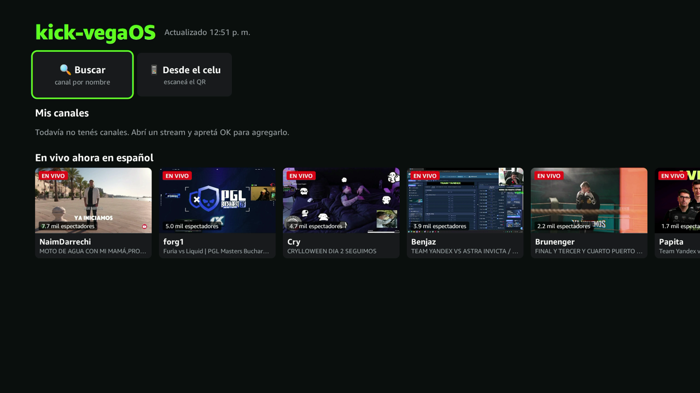

<p align="center"></p>

# kick-vegaOS

An unofficial, lightweight [Kick](https://kick.com) player for Fire TV devices
running **Vega OS** (for example the Fire TV Stick 4K Select), where there is
no Kick app and apps can only be installed from the Amazon Appstore or in
developer mode.

> **Disclaimer:** kick-vegaOS is an independent, personal project. It is not
> affiliated with, endorsed by or connected to Kick or Amazon. "Kick" is a
> trademark of its owner and is used here only to say which service the app
> plays.
>
> Kick does not offer an official API for playing streams. This app uses the
> same undocumented endpoints as kick.com, which may change or stop working at
> any time, and **using a third-party client may go against
> [Kick's Terms of Service](https://kick.com/terms-of-service)** (for example
> §1.4, on accessing the service through means it hasn't authorized). Read them
> and decide for yourself; you are responsible for how you use it. The app
> doesn't download, record or redistribute streams: it plays them live, like
> the website does. Provided as is, without warranty (see [LICENSE](LICENSE)).
>
> If you represent Kick and want something changed or removed, please
> [open an issue](https://github.com/agusszarate/kick-vegaOS/issues).



The full kick.com site is too heavy for a device with 1 GB of RAM. kick-vegaOS
is a small React Native app that shows only what a TV needs and plays the
streams with Vega's native video pipeline.

## Features

- **Live now in Spanish**: the 24 most watched Spanish streams.
- **My channels**: favorites, live ones first. Press OK while watching to add or remove one.
- **Search** by channel name with the on-screen keyboard.
- **Zapping**: ▲/▼ while watching switches to the previous/next live channel of the same list.
- **Send from your phone**: scan a QR code and type a channel name or paste a Kick link; the TV opens it (see [Privacy](#send-from-your-phone-and-privacy)).
- Video capped at 720p, scaled UI with a TV-safe margin for overscan.

Not supported: logging in, chat, channel points and subscriptions. Kick's
public API has no endpoint for followed channels and no TV login flow, and
channel points are only earned through Kick's own player.

## Requirements

- A Fire TV device with **Vega OS** in **developer mode**, on the same network as your computer.
- An [Amazon Developer account](https://developer.amazon.com) (free).
- The [Vega SDK](https://developer.amazon.com/docs/vega/0.24/install-vega-sdk.html) and Node.js 20+.
- Git, Python 3 and Java 11+ to build the video player (see [How it works](#how-it-works)).

## Build and install

1. Install the Vega SDK and log in with your developer account:

   ```bash
   vega devmode login
   ```

2. On the Fire TV: **Settings → My Fire TV → About**, press OK seven times on the
   device name, then **Developer options → Developer Mode**. Enter the code it
   shows:

   ```bash
   vega devmode enable-device --code <CODE>
   ```

   The device reboots. Then set **Developer options → Connection mode** to
   **TCP/IP** and connect to it (the IP is under **About → Network**):

   ```bash
   vega exec vda connect <FIRE_TV_IP>:5555
   ```

3. Build and install:

   ```bash
   npm install
   npm run build:release
   vega run-app build/armv7-release/kick-vegaos_armv7.vpkg ar.agus.kickvegaos.main
   ```

   The first `npm install` also builds the video player, which takes a couple
   of minutes. Use the package that matches your device's architecture
   (`vega device info`).

> **Note:** the Vega build tools fail when the project path contains spaces
> (for example macOS's `Application Support`). Clone it somewhere without them.

To publish your own build, change the package id `ar.agus.kickvegaos` in
`manifest.toml` and `app.json`. Ids starting with `com.amazon` are not allowed.

## Using it

| Where | Key | Action |
|---|---|---|
| Home | ◀ ▲ ▼ ▶ | Move between cards |
| Home | OK | Open a channel, search, or the phone QR |
| Home | Back | Exit |
| Watching | OK | Add to / remove from *Mis canales* |
| Watching | ▲ ▼ | Previous / next live channel |
| Watching | Back | Back to the list |

### Send from your phone and privacy

On first run the app creates a random topic on [ntfy.sh](https://ntfy.sh), a
free, open-source notification service, and listens to it while open. The QR
code opens `https://ntfy.sh/<topic>` on your phone; publish a channel name or a
Kick link there and the TV opens it.

- Only the channel names you send go through ntfy.sh, and ntfy.sh can see them.
- Topics have no password: anyone who knows yours could make your TV open a
  Kick channel. The app ignores everything else.
- To keep messages inside your network, [self-host ntfy](https://docs.ntfy.sh/install/)
  and change `NTFY_SERVER` in `src/lib/phone.ts`.

### Home automation

In developer mode the device accepts commands over the network with plain
`adb`, so tools like Home Assistant can open the app:

```bash
adb connect <FIRE_TV_IP>:5555
adb shell vlcm launch-app orpheus://ar.agus.kickvegaos.main
```

> **Security:** in developer mode *any* device on your network can control the
> Fire TV this way, without confirmation.

## How it works

```
src/App.tsx            screens, remote control, refresh, favorites, zapping
src/screens/           home grid, player, search and phone overlays
src/player/
  StreamPlayer.ts        Vega W3C Media API + Shaka Player for one stream
  quality.ts             Shaka settings (720p cap, small buffers)
src/lib/
  kick.ts                Kick API client
  focus.ts rows.ts       grid focus, home rows, zapping
  phone.ts               ntfy listener and QR code
  storage.ts             favorites and the ntfy topic (AsyncStorage)
scripts/setup-shaka.sh builds the video player into src/vendor/ (not committed)
manifest.toml          Vega package manifest
```

The app talks to Kick's web endpoints and Amazon IVS (the video CDN Kick uses)
directly from React Native, so no backend is needed.

### The video player

Vega plays adaptive streams through its
[W3C Media API](https://developer.amazon.com/docs/vega/0.24/media-player.html):
a JavaScript player (here [Shaka Player](https://github.com/shaka-project/shaka-player))
downloads and parses the HLS stream and feeds the device's hardware decoder.
Shaka needs patches to run outside a browser. Amazon publishes them, with a few
polyfills, in its [Vega Video Sample App](https://github.com/AmazonAppDev/vega-video-sample).

Those files aren't part of this repository: on `npm install`,
`scripts/setup-shaka.sh` downloads them from a pinned commit of Amazon's sample
(checking its SHA-256), applies them to the official Shaka Player 4.8.5 and
builds it into `src/vendor/`. Run `bash scripts/setup-shaka.sh --force` to
rebuild.

### Memory

Live streams play for hours on a device with 1 GB of RAM, so the player keeps
little video around: about 12 seconds ahead and 4 behind, evicted as it plays,
capped at 720p, with text tracks off (Kick sends ID3 and `EXT-X-DATERANGE`
metadata every 1-2 seconds). Only one native player exists at a time; zapping
destroys the current one before creating the next. See
`src/player/quality.ts`.

To check memory on a device, play a stream and run
`vega exec perf memory-monitor --app-name ar.agus.kickvegaos.main`.

## Development

```bash
npm run check   # typecheck + lint + tests
npm run build   # release .vpkg for every architecture
```

Device logs: `vega device start-log-stream`.

## License

[MIT](LICENSE). Kick is a trademark of its owner. The icon is original and not
Kick's logo.

The video player is built at install time from
[Shaka Player](https://github.com/shaka-project/shaka-player) (Apache 2.0) and
Amazon's Vega patches and polyfills from the
[Vega Video Sample App](https://github.com/AmazonAppDev/vega-video-sample),
under their own licenses. None of them are included in this repository.
